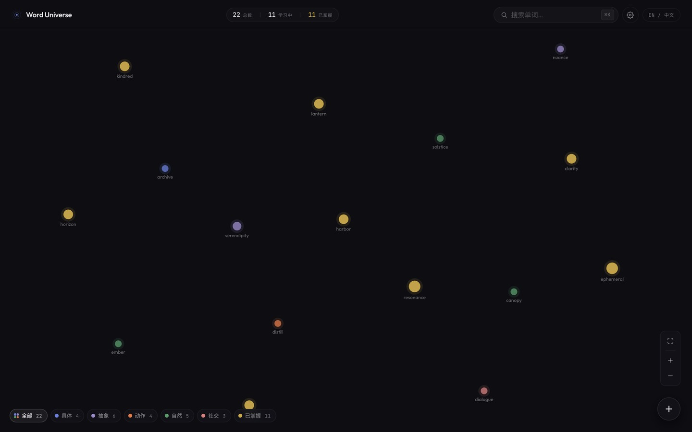
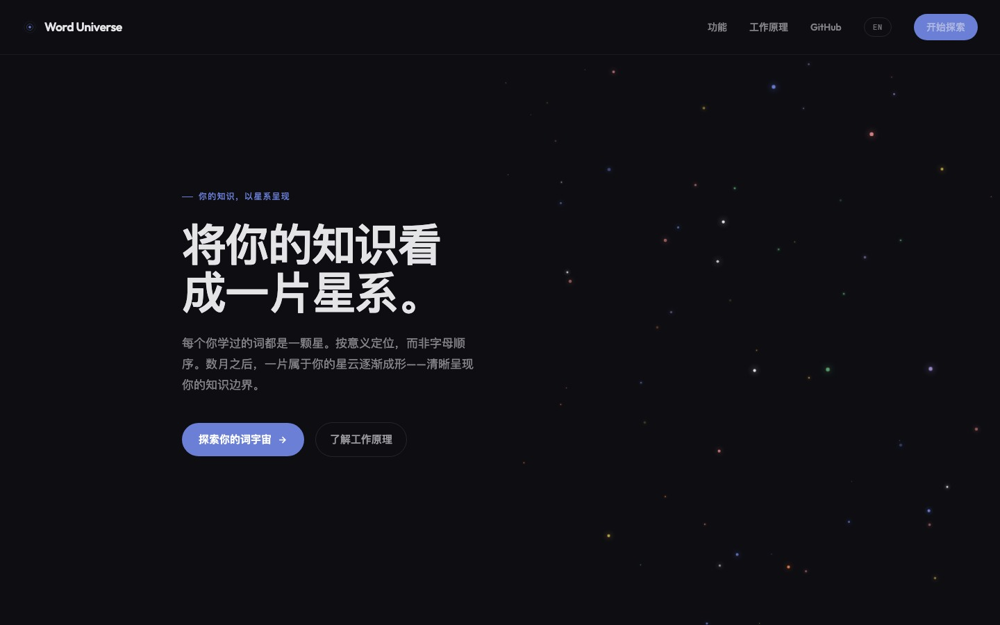

<div align="center">

# Word Universe · 词义星系

**背单词不该只是死磕字母表——把学过的词放进一片可漫游的星空，按词义彼此吸引。**

<p>
  <a href="https://nuts-and-bytes.github.io/word-universe/app/"><strong>漫游词义星系 ↗</strong></a> ·
  <a href="https://nuts-and-bytes.github.io/word-universe/">项目首页</a> ·
  <a href="#快速开始">本地运行</a> ·
  <a href="#english">English</a>
</p>

<br />



</div>

## 为什么做它

词与词之间本来就有引力：抽象概念聚在一边，自然意象浮在另一侧，熟透的词应该比生词更亮。

**Word Universe** 把你的个人词库画成一张 D3 力导向星图。每个新词都是一颗星，按词义聚类而不是拼写顺序排列；你标记的掌握度会让已经吃透的词发出金色微光，一眼就能看清自己知识版图的形状。

## 画面与核心体验

|  |  |
| :---: | :---: |
| *将你的知识看成一片星系* | *按语义聚类、支持搜索与 0–3 级掌握度点亮* |

- **语义星空探索**：基于 D3.js 力导向图自由拖拽、缩放与点击查看词条释义、例句和相似词。
- **0–3 级掌握度点亮**：随复习进度更新掌握等级，已掌握词汇以金色星点突出显示。
- **开箱即用 + 可选语义向量**：不配 API Key 即可用本地启发式排布立即上手；填入 OpenAI Key 后可启用 `text-embedding-3-small` 向量获得更细腻的语义聚集。
- **多端轻量化**：纯静态前端、支持中英文切换与 `⌘K` 快捷搜索。

## 快速开始

纯静态前端，只需 Python 3 即可启动，无需数据库或后端服务：

```bash
git clone https://github.com/nuts-and-bytes/word-universe.git
cd word-universe
python3 -m http.server 8000
```

浏览器打开 <http://localhost:8000/app/> 即可开始添加你的第一颗词星。

<details>
<summary><strong>目录结构、AI 向量与本地数据边界</strong></summary>

<br />

- **核心文件**：`app/app.js`（词库管理、分类、语义向量与星空交互）、`app/index.html`、`app/style.css`；推送 `main` 由 [.github/workflows/pages.yml](.github/workflows/pages.yml) 自动发布到 GitHub Pages。
- **OpenAI Embedding 说明**：仅当你在设置中主动填入自己的 OpenAI API Key 时，新增单词才会调用 `text-embedding-3-small`（截取前 16 维参与计算）并产生对应平台费用；未配置或失败时自动回退至本地启发式算法（当前未接入 MiniMax）。
- **数据存储**：词库与设置保存在当前浏览器 `LocalStorage`，不会自动跨设备同步，清理站点数据前请及时备份。
- **反馈与许可**：问题欢迎提 [Issue](https://github.com/nuts-and-bytes/word-universe/issues)；仓库目前未含独立 `LICENSE` 文件。

</details>

## English

**Word Universe (词义星系)** visualizes your personal vocabulary as an interactive D3 force-directed galaxy—grouping words by meaning instead of alphabetical order, with 0–3 mastery tracking that lights mastered words in gold.

- [Try it online ↗](https://nuts-and-bytes.github.io/word-universe/app/) · [Landing page ↗](https://nuts-and-bytes.github.io/word-universe/)
- Works out of the box with local heuristic layout, or optionally connects to OpenAI `text-embedding-3-small` embeddings using your own browser-stored API key. Run locally with `python3 -m http.server 8000` and open `/app/`.

---

<p align="center">made by <a href="https://heystone.site/">stone</a> · 为 AI 世界留一点人味</p>
